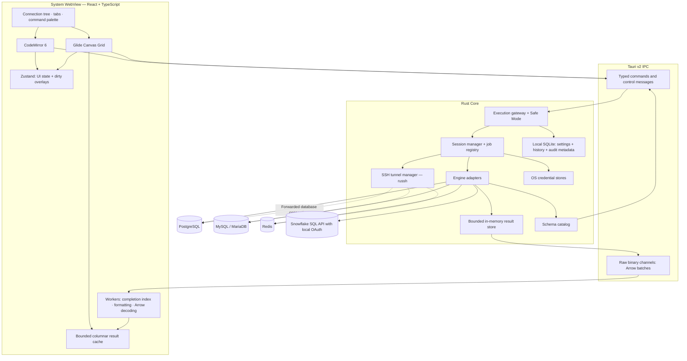

# Desktop Database Studio Development Blueprint

Build a **Tauri v2 application with a React interface and a Rust execution core**. Rust owns connections, credentials, query execution, write authorization, result retention, and database metadata. React owns interaction, presentation, and transient editing state.

The agreed release path is:

- **macOS first**, with Windows and Linux smoke tests from the foundation phase and supported releases by v1.0.
- **PostgreSQL MVP**, followed by MySQL/MariaDB, Redis, and Snowflake.
- **Memory-only result storage** with explicit retention limits.
- **Password-gated production writes**.
- **Native async Rust drivers**: `tokio-postgres` and `mysql_async`, preserving the rest of the preferred stack.

Use [DBNerd](https://github.com/nerd-riot/db-nerd) as a UX reference. Treat its published performance figures as targets to validate independently.

# Architecture and engineering targets

## High level architecture



## Performance acceptance targets

Measure packaged release builds on a documented Apple Silicon machine with a 120 Hz display. Keep startup, empty idle, connected idle, and active-query measurements separate.

| Metric | Initial acceptance target |
|---|---|
| Empty idle memory | Aim for 50–80 MB attributable app footprint, including WebView helpers; report per-process RSS separately |
| Cold start | p95 below one second to an interactive shell, without waiting for network connections |
| Grid scrolling | Sustained 100+ FPS on a 120 Hz display with representative data |
| Completion | Warm prefix lookup p95 below 5 ms; visible suggestions below 50 ms |
| Result display | Batch arrival to visible update p95 below 50 ms |
| Retention | Memory reaches a bounded plateau during long result streams |
| Cleanup | Repeated open/run/close cycles release result buffers, sessions, and tunnel resources |

These are **release gates to investigate and demonstrate**, rather than guarantees supplied by the stack. A 60 Hz display cannot demonstrate 100+ rendered FPS.

## Key technical decisions

| Area | Decision and trade-off |
|---|---|
| Desktop shell | Tauri v2; rely on the system WebView and keep privileged operations in Rust |
| Editor | CodeMirror 6; modular extensions and lazy loading suit the startup and memory goals |
| Grid | Glide Data Grid behind an application wrapper; mature Canvas rendering avoids building selection, editing, and clipboard behavior from scratch |
| Remote drivers | `tokio-postgres`, `mysql_async`, and `redis-rs`; engine-specific adapters preserve cancellation, transport, and session behavior |
| IPC | JSON for control messages; raw binary channels for Arrow data |
| Autocomplete | Compact sorted prefix indexes in a worker; simpler and less object-heavy than a JavaScript object-per-node trie |
| Local persistence | SQLite for application metadata; OS credential stores for secrets; result rows remain in memory |
| Architecture | One Rust crate with clear modules initially; no local HTTP server or driver sidecars |

The driver change addresses a concrete SSH/TLS requirement: PostgreSQL exposes separate host and dial-address configuration, while MySQL’s `resolved_ips` preserves the hostname for TLS verification. PostgreSQL also exposes native cancellation tokens. [PostgreSQL configuration](https://docs.rs/tokio-postgres/latest/tokio_postgres/config/struct.Config.html), [MySQL connection options](https://docs.rs/mysql_async/latest/mysql_async/struct.OptsBuilder.html), [PostgreSQL cancellation](https://docs.rs/tokio-postgres/latest/tokio_postgres/struct.CancelToken.html).

# Project structure and core interfaces

## Frontend

```text
src/
├── main.tsx
├── app/
│   ├── App.tsx
│   ├── layout/
│   ├── commands/             # Command registry and scoped shortcuts
│   └── themes/               # Shared UI, editor, and grid tokens
├── features/
│   ├── connections/          # Groups, profiles, authentication forms
│   ├── studio/               # Editor tabs, execution, result subtabs
│   ├── catalog/              # Schema browser and table statistics
│   ├── grid/                 # Glide wrapper, editors, dirty overlays
│   ├── safety/               # Approval and SQL review dialogs
│   ├── processes/
│   ├── history/
│   └── redis/                # Native command console and key browser
├── components/
│   └── ui/                   # Accessible shared controls
├── state/                    # Small Zustand stores and selectors
├── data/
│   ├── result-cache.ts
│   ├── columnar-access.ts
│   └── value-formatting.ts
├── ipc/
│   ├── client.ts             # Typed invoke/channel wrappers
│   ├── contracts.ts
│   └── errors.ts
├── workers/
│   ├── completion.worker.ts
│   ├── formatter.worker.ts
│   └── arrow.worker.ts
└── test/
```

## Rust

```text
src-tauri/
├── Cargo.toml
├── build.rs
├── tauri.conf.json
├── capabilities/
├── permissions/
├── migrations/               # Application SQLite migrations only
├── src/
│   ├── main.rs
│   ├── lib.rs
│   ├── commands/             # Thin Tauri boundary handlers
│   ├── domain/               # IDs, values, capabilities, error types
│   ├── connections/           # Profiles, sessions, health, lifecycle
│   ├── execution/            # Gateway, plans, jobs, cancellation
│   ├── drivers/
│   │   ├── mod.rs
│   │   ├── postgres/
│   │   ├── mysql/
│   │   ├── redis/
│   │   └── snowflake/
│   ├── results/              # Arrow encoding and retention budgets
│   ├── editing/              # Provenance, change plans, transactions
│   ├── catalog/              # Introspection and cache invalidation
│   ├── safety/               # Classification, policies, approvals
│   ├── ssh/                  # Authentication, forwarding, known hosts
│   ├── secrets/
│   ├── persistence/
│   └── observability/
├── tests/                    # Real database and SSH integration tests
└── benches/
```

Keep database and safety modules independent of Tauri so integration tests can exercise the real core directly.

## Ownership and contracts

Use opaque identifiers across IPC:

- `ConnectionId`: saved profile.
- `SessionId`: authenticated connection context, including its generation.
- `RunId`: execution job.
- `ResultId`: retained result set.
- `PlanId`: immutable SQL or grid-change plan.
- `ApprovalId`: short-lived authorization for one plan.

Define a driver capability descriptor covering SQL execution, transactions, cancellation, table browsing, editing, process inspection, and administrative actions. The frontend renders features from those capabilities.

Use a small engine adapter boundary with operations for:

- Opening and closing sessions.
- Executing a request as a stream of metadata, rows, notices, and completion events.
- Cancelling a run.
- Introspecting schemas.
- Browsing tables.
- Inspecting and controlling processes.

## Initial IPC surface

| Command family | Responsibility |
|---|---|
| `connection_*` | Save profiles, manage groups, test/open/close connections |
| `catalog_*` | Load schemas, columns, keys, indexes, and statistics |
| `prepare_execution` | Parse and classify the exact submitted SQL |
| `prepare_changes` | Validate grid edits and generate a parameterized change plan |
| `authorize_plan` | Verify required confirmation/passphrase and issue an approval |
| `execute_plan` | Start the immutable plan and return a `RunId` immediately |
| `cancel_run` | Request cancellation and track the eventual outcome |
| `result_*` | Request retained ranges, grant channel credits, release results |
| `process_*` | List processes and prepare explicitly authorized administrative actions |
| `history_*` | Search, reopen, and delete permitted history |

Generate TypeScript DTOs from Rust definitions before local checks and builds. Run `pnpm validate` before shipping and review generated contract changes. Keep channel framing versioned.

Separate **execution status** from **result retention status**: a statement can finish successfully while its displayed rows are truncated.

# Implementation blueprint

The [DataGrip feature matrix](datagrip-feature-matrix.md) records the current
source/test comparison, including verified gaps and intentional restrictions.
The [implementation roadmap](implementation-roadmap.md) adds a dependency-ordered
delivery sequence without replacing these milestones or the private project
hub's shipping status. Its first batch repairs SQL completion scope, quoting and
stale responses; that bounded repair shipped in preview.12 (see the matrix
evidence). The PostgreSQL live role/search-path slice shipped in preview.13; see
[live completion context](live-completion-context.md). The subsequent
[MySQL/MariaDB live slice](mysql-live-completion-context.md) shipped in
preview.14. PR #23 qualifies case mode 1 on disposable MySQL and MariaDB;
mode 2 remains open. The bounded [Snowflake request-context slice](snowflake-completion-context.md)
shipped in preview.15 with synthetic verification; live qualification and full
search-path inference remain open. The [isolated query-session slice](isolated-query-sessions.md)
is locally verified on PostgreSQL/MySQL/MariaDB: 26 browser workflows, desktop
build/bundle and three native runs pass after host resources recovered. It is
unreleased. Grouped foreign-key metadata and JOIN generation follow.
The measured warm lookup target passes, while visible completion latency and
representative native performance remain open qualification work.

## SQL Studio and session management

### Execution behavior

- `Mod+Enter`: execute selection, otherwise the statement under the cursor.
- `Mod+Shift+Enter`: execute the script.
- Preflight the complete submitted batch before any statement runs.
- For PostgreSQL/MySQL, run statements sequentially on one pinned session; stop on the first error.
- Create result subtabs for each statement and each returned result set, including empty results.
- Preserve earlier results when a later statement fails.
- Do not automatically wrap arbitrary scripts in a transaction: DDL and transaction behavior differ by engine.

Use dialect-aware parsing and tokenization. Never split SQL with `split(";")`; quoted strings, comments, PostgreSQL dollar quoting, and procedural bodies make that unsafe. Reject unsupported client directives such as MySQL `DELIMITER` with a precise explanation.

### Editor

- Mount CodeMirror once per active editor view; retain inactive documents without keeping every editor mounted.
- Add syntax highlighting, bracket matching, search, diagnostics, folding, and completion.
- Run SQL formatting on demand in a worker using the selected dialect.
- Map Rust byte offsets to JavaScript UTF-16 offsets when displaying errors.
- Preserve SQL text and comments through formatting and execution.

### Sessions

- Create connections lazily.
- Default to one foreground execution lane per open workspace.
- Allow up to four user execution sessions per profile, plus one lazily opened metadata/control connection.
- Serialize operations within a session to preserve transactions, temporary objects, and session variables.
- Expire idle auxiliary connections.
- Never hold a global connection-registry lock while awaiting network I/O.

Display queue time, time to first row, client elapsed time, rows fetched, affected rows, and server-reported metrics where available. Do not label client elapsed time as server execution time.

## IPC and bounded result retention

Use two logical paths:

1. Typed commands/control channels for lifecycle and metadata.
2. Raw binary channels for Arrow batches.

For binary channels, use `Channel<InvokeResponseBody>` with `InvokeResponseBody::Raw`, received as `Channel<ArrayBuffer>`. A `Channel<Vec<u8>>` serializes its bytes as a JSON number array. Verify the actual payload type on every supported packaged build. [Tauri channel documentation](https://docs.rs/tauri/latest/tauri/ipc/struct.Channel.html).

### Protocol defaults

- Batch target: approximately 512 rows or 256 KiB.
- Maximum normal batch: 1 MiB.
- Flush partial batches within approximately 20 ms while streaming.
- Include protocol version, result identity, sequence, and row range in each frame.
- Allow at most four unacknowledged batches.
- Send data only to the owning window.
- Treat channel failure or window closure as a resource-cleanup event.

Implement application-level credits: `Channel::send` is not a sufficient backpressure mechanism. Avoid global Tauri events for result transport; those events are intended for small messages and use JSON payloads. [Tauri frontend communication](https://v2.tauri.app/develop/calling-frontend/).

### Memory only defaults

- Rust retained-result budget: **64 MiB globally**.
- Frontend columnar cache: **32 MiB globally**.
- Dirty-edit budget: **8 MiB globally**.
- Arbitrary-query row limit: **100,000 rows per statement**, subject to the byte budget.
- Reserve capacity before accepting each batch.
- Require explicit result release when the budget is exhausted; never silently evict another query’s retained results.
- Free retained rows when a result closes. Do not persist result rows in SQLite, IndexedDB, or temporary files.

For a read query, reaching the retention limit stops fetching, requests cancellation where appropriate, and marks the result truncated. For a write returning rows, discard excess output while determining the write outcome; a display limit must not implicitly cancel a mutation.

Arrow improves columnar access and serialization efficiency, but Tauri IPC still involves copies. Include those transient copies in memory measurements.

### Value fidelity

- Preserve SQL NULL separately from empty strings.
- Preserve signed/unsigned 64-bit integers without converting them to JavaScript `number`.
- Represent arbitrary-precision decimals as exact strings with database type metadata.
- Preserve timestamp precision and timezone semantics.
- Provide explicit binary and large-value viewers.
- Render unfamiliar types through a lossless text or binary fallback and disable editing.
- Derive column types from driver metadata, including zero-row results.

## Virtualized grid paging and editing

### Rendering

Implement one `DatabaseGrid` wrapper around Glide:

- Keep `getCellContent` synchronous and allocation-light.
- Read columnar buffers and apply a sparse dirty overlay.
- Schedule page fetches from visible-region changes.
- Batch invalidations with `requestAnimationFrame`.
- Use `updateCells` for affected cells.
- Keep large result buffers outside React and Zustand.
- Start with fixed row heights and bounded cell previews.
- Decode Arrow in a worker and transfer typed buffers and descriptors back to the cache.

Glide leaves underlying data ownership to the application; its editing callbacks and targeted invalidation API fit this model. [Editing API](https://docs.grid.glideapps.com/api/dataeditor/editing), [cell invalidation](https://docs.grid.glideapps.com/api/dataeditorref).

### Two browsing modes

| Mode | Behavior |
|---|---|
| Arbitrary SQL results | Scroll through retained rows; show an explicit limit when truncated |
| Table browser | Fetch 500-row keyset pages with bounded caching; fetch further pages as scrolling approaches the end |

For table browsing:

- Order by the complete primary key by default.
- Add primary-key tie breakers to supported user sorts.
- Generate parameterized predicates with correct NULL ordering.
- Re-fetch evicted pages when requested.
- Label browsing as a live view: concurrent database changes can alter pages.
- Avoid automatic full-table `COUNT(*)`.
- Use explicit bounded paging for tables without a stable ordering key.

This supports continuous browsing of large tables without retaining the entire table. It cannot provide unlimited, stable random access to arbitrary query output under a fixed memory budget.

### Editable scope

Through v1.0, enable editing for PostgreSQL/MySQL table-browser rows with backend-owned provenance.

Require:

- A real primary key, including all columns of composite keys.
- A physical, transaction-capable table.
- Editable database types.
- Original row identity and values retained in Rust.

Keep arbitrary SQL results, joins, views, aggregates, generated columns, and primary-key changes read-only through v1.0. Never infer a key from a column named `id` or `*_id`.

### Dirty tracking

Track edits by:

```text
result identity + original primary-key tuple + column identity
    → original value, proposed value, validation state
```

- Reverting to the original value removes the dirty entry.
- Sorting and paging preserve edits by row identity.
- Dirty rows remain pinned within the edit budget.
- Type-aware editors distinguish NULL, empty text, and default behavior.
- Paste validates the complete proposed edit set before applying it locally.
- Closing or refreshing dirty results requires an explicit save/discard choice.

### Commit workflow

1. Rust validates changes and creates an immutable change plan.
2. The review modal shows target connection, table, rows, SQL, and typed bindings.
3. Production authorization applies to that exact plan.
4. Begin a transaction.
5. Lock target rows in deterministic key order.
6. Compare current values against the retained originals.
7. Execute parameterized updates and require one matched row per edit.
8. Roll back the whole change set on conflicts, constraints, or unexpected counts.
9. Commit, refresh server values, and clear confirmed edits.

Limit a change set to 500 rows initially. Reject nontransactional MySQL tables. Enable matched-row reporting so unchanged MySQL values do not appear to be missing rows.

Make generated SQL read-only in the review modal. “Send to editor” creates a new execution path and does not automatically mark grid edits as saved.

## SSH tunneling lifecycle

Use **russh** for asynchronous SSH on the existing Tokio runtime. Its client supports password authentication, agent-backed public-key authentication, and `direct-tcpip` channels. [russh client API](https://docs.rs/russh/latest/russh/client/struct.Handle.html).

Implement one configured bastion per connection in v1.0:

```text
Disconnected → Connecting → VerifyingHost → Authenticating → Ready
                                                       ↓
                                                 Failed / Closing
```

### Lifecycle rules

- Authenticate with password, encrypted private key, or ssh-agent.
- Use ssh-agent only for signing; disable agent forwarding.
- Verify known hosts before database authentication.
- Require fingerprint acceptance for unknown hosts and block changed host keys.
- Bind forwarding listeners to `127.0.0.1:0`.
- Open one SSH channel per accepted database connection.
- Resolve private database hostnames from the bastion.
- Reference-count tunnel leases across sessions and control connections.
- Close the listener, channels, tasks, and SSH session after the last lease.
- Use keepalives, connection deadlines, and bounded reconnect backoff.
- Reconnect transport only; never replay submitted SQL.

### TLS identity

Keep database identity separate from the local forwarding address:

- PostgreSQL: original database hostname plus loopback `hostaddr` and the forwarded port.
- MySQL: original hostname plus loopback `resolved_ips`, forwarded port, and socket preference disabled.
- Redis: construct a verified TLS stream using the original hostname and pass it to the async connection layer.

Test CA validation, hostname validation, and client certificates through the tunnel. Do not weaken TLS verification to make forwarding work.

On sleep, disconnect, or tunnel failure, mark in-flight executions accurately and invalidate session-bound approvals.

## Schema indexing and autocomplete

Keep Rust authoritative for schema metadata. Keep completion lookup local to a frontend worker.

### Loading strategy

1. Load available databases/schemas and object names.
2. Load columns, primary keys, foreign keys, and indexes for expanded or active schemas.
3. Fetch expensive statistics separately, on demand.
4. Persist permission-scoped metadata caches with timestamps.
5. Publish schema revisions to the completion worker.

Key caches by connection identity, database, authenticated identity, active role, and search path. Never reuse metadata across role changes.

### Completion index

Use sorted normalized search keys with original identifiers retained:

- Binary-search the prefix range.
- Return at most 100 ranked candidates.
- Rank aliases and columns in the current query scope first.
- Preserve quoted identifier case and dialect-specific quoting.
- Use foreign-key relationships for JOIN suggestions.
- Keep CodeMirror context analysis separate from catalog lookup.

A compact sorted index provides `O(log n + k)` prefix lookup without the object overhead and maintenance cost of a custom trie. Benchmark it against at least 100,000 catalog names.

Invalidate affected metadata after successful DDL, role changes, and database changes. Refresh active stale scopes after 60 seconds; provide manual refresh for external changes. Discard worker responses carrying obsolete document or schema revisions.

## Safe Mode enforcement

Enforce policy in the **Rust execution gateway**. UI warnings are presentation of that decision.

| Level | Behavior | Default |
|---|---|---|
| Silent | Normal authorized execution without safety prompts | Local |
| Confirm | Confirm mutations and destructive administrative actions | Staging |
| Guard | Confirm writes; elevated confirmation for missing WHERE, trivial unrestricted predicates, and destructive DDL | Optional |
| Password-gated | Guard behavior plus application passphrase for each write batch | Production |
| Read-only | Reject mutations and unsupported/unknown operations | Optional |

Production policy changes and group moves that reduce protection require the application passphrase.

### Classification

Use dialect-specific AST inspection, including nested statements. Cover INSERT, UPDATE, DELETE, MERGE, destructive DDL, COPY/import operations, permission changes, calls, scripts, and administrative actions.

Protected modes treat unparseable or unclassified SQL as requiring elevated approval. A missing-WHERE detector cannot establish that a predicate is selective, and a SELECT can call functions with side effects. Database privileges remain the authoritative protection; support and encourage separate read-only production profiles.

### Enforcement points

Apply the gateway to:

- Editor execution and history replay.
- Grid changes.
- Redis commands.
- Process cancellation and termination.
- Administrative controls.
- Connection-policy changes.
- Future import and automation features.

Keep internal metadata queries backend-owned and allowlisted.

### Approval design

- Use an application passphrase, verified with Argon2id.
- Keep the verifier in the OS credential store.
- Bind approval to the plan digest, parameters, connection/session generation, database/role, and policy revision.
- Expire approvals after 60 seconds and consume them once.
- Invalidate approval after SQL edits, reconnects, or policy changes.
- Never persist passphrases or approval tokens.

If the passphrase has not been configured, production writes remain blocked until setup completes.

## Cancellation failures and observability

Maintain a job registry with:

```text
Queued → Running → Cancelling → Completed / Failed / Cancelled / OutcomeUnknown
```

- **PostgreSQL:** use the native cancellation token, then observe the execution result. A successful cancellation request does not prove the query was cancelled. [Cancellation semantics](https://docs.rs/tokio-postgres/latest/tokio_postgres/struct.CancelToken.html).
- **MySQL/MariaDB:** use a separate control connection and `KILL QUERY`, with permission-aware errors.
- **Redis:** separate blocking operations from shared multiplexed connections. Dropping a request future does not cancel a command already sent to Redis. [Redis async connection behavior](https://docs.rs/redis/latest/redis/aio/struct.MultiplexedConnection.html).
- **Snowflake:** cancel by statement handle and poll the final status; discard a session after an explicit cancellation until the terminal outcome is known.

Keep an execution session quarantined while cancellation is unresolved so a late cancellation request cannot hit a subsequent query. Drain protocol state or discard the connection before reuse.

After a lost connection during commit, report **outcome unknown**. Preserve the edit plan in memory and require reconciliation; never automatically retry a write.

For health checks, use recent traffic as evidence first, then lightweight idle checks approximately every 30 seconds. Suspend checks during sleep and reduce background frequency.

Expose process lists and table statistics with permission-aware degradation. Label estimated row counts and stale statistics. Make exact counts and intrusive diagnostics explicit actions.

## Engine specific behavior persistence and UX

### Redis

Provide a dedicated key browser and command console:

- Cursor-based `SCAN`, never automatic `KEYS`.
- Type and TTL inspection.
- Bounded string/hash/list/set/sorted-set viewers.
- Type-aware edits through the same safety gateway.
- Explicit treatment of expired keys and duplicate SCAN results.
- Standalone Redis in v1.0; Cluster and Sentinel are stretch goals.

Current implementation uses redis-rs for command encoding and RESP2 parsing
over an owned async TCP/TLS stream. A framing guard checks declared lengths,
node count and depth before decoding (2 MiB / 10,000 / 16). This avoids an
uncancellable background multiplexed task. Blocking, scripting, transaction and
administrative commands are rejected before the complete batch is submitted.
All writes require immutable one-use review; production adds the passphrase gate.
Browser cursors are opaque, scoped to pattern/key/type and expire after five
minutes. Preview limits are explicit; no unbounded KEYS/HGETALL/SMEMBERS reads.
String forms keep TTL; values may change after inspection and command batches
have no automatic rollback. Lost write acknowledgements are outcome unknown.

### Snowflake

Use Snowflake's built-in local-application OAuth authorization-code flow with
PKCE through the system browser, then call the SQL API through Rust HTTP. This
avoids a separate ODBC installation and does not require a user-entered token.
Confirm that the account's `SNOWFLAKE$LOCAL_APPLICATION` integration is enabled.
Keep access and refresh tokens in memory only. [Snowflake OAuth for local applications](https://docs.snowflake.com/en/user-guide/oauth-local-applications).

The read-only SQL pilot has browser sign-in, explicit context, bounded results,
async polling, and own-query cancellation. One live account passed browser SSO,
identity checks, and `SELECT 1`. Preview.3 ships catalog discovery, lazy
schema-aware completion, structure inspection, and read-only table previews.
These additions passed synthetic API/browser fixtures; broader live table/account
qualification and full P6 exit criteria remain open.

Discover accessible objects in the configured database through
`INFORMATION_SCHEMA.TABLES`, including metadata row/byte estimates; never run
`COUNT(*)` automatically. Stop with an explicit error above 10,000 objects or
8 MiB of retained metadata. Fetch column metadata lazily with a zero-row SELECT,
and keep its local SQL API handle separate from the editor's cancellation handle.
Read all metadata partitions within response/partition budgets; reject incomplete
catalog results rather than silently omitting objects.

Table previews use quoted, fully qualified identifiers and an explicit projection,
stop at 500 rows or 2 MiB, and expose truncation. They are unordered single pages;
larger or ordered results belong in SQL Studio. All columns stay read-only.
Do not infer keys or use standard-table declarations for paging/editing:
[Snowflake does not enforce standard-table PK/FK constraints](https://docs.snowflake.com/en/sql-reference/constraints-overview).

Complete P6 with:

- Account-specific browser OAuth qualification and optional key-pair support for service accounts.
- Explicit account, role, warehouse, database, and schema context.
- Async submission, status polling, cancellation, and partition retrieval.
- SQL results converted to the same internal Arrow representation.
- Read-only grids in v1.0.
- No warehouse-resuming heartbeat queries.

Submit an explicit transaction as one HTTP request with the correct statement count. Disable cross-request interactive transactions and persistent temporary-session assumptions. Snowflake determines result partition sizes, so enforce response budgets while parsing. [SQL API limitations](https://docs.snowflake.com/en/developer-guide/sql-api/intro), [transaction requirements](https://docs.snowflake.com/en/developer-guide/sql-api/using-transactions).

### Persistence and secrets

- Store groups, profiles, preferences, drafts, schema caches, and permitted history in local SQLite.
- Store credentials and private-key secrets in platform credential stores.
- Provide session-only credentials when secure storage is unavailable.
- Default production history to metadata only; make SQL text and draft persistence opt-in.
- Default history retention to 30 days or 10,000 entries.
- Keep bound values and result rows out of audit records and application logs.
- Describe the local audit trail as an operational aid; centralized compliance auditing is a later feature.

### Polish

Use a command registry shared by menus, palette, and shortcuts. Start with light, dark, and high-contrast themes using common editor/grid/UI tokens. Include keyboard navigation, visible focus, adjustable density, persistent environment labels, and an accessible selected-cell inspector.

# Phased roadmap

Estimates are **engineer-weeks for one experienced Rust/TypeScript developer**, excluding major design changes. Complexity reflects implementation and verification risk.

| Phase | Deliverable and milestone exit criteria | Complexity | Estimate |
|---|---|---|---|
| P0: Feasibility | Packaged Tauri shell; real Arrow IPC; million-row virtual grid fixture; memory measurements; verified TLS through SSH; PostgreSQL cancellation | High | 1–2 |
| P1: Foundation | Connection/group persistence, credential stores, typed contracts, capabilities, command registry, local validation and free public-repository CI across platforms | Medium | 2–3 |
| P2: PostgreSQL Studio | Editor, schema browser, autocomplete, multiple results, metrics, history, bounded retention, table paging | High | 3–4 |
| P3: PostgreSQL MVP | Inline editing, transactional review/apply, all Safe Mode levels, SSH authentication methods, health, processes, signed macOS build | Very high | 4–6 |
| P4: MySQL/MariaDB | Adapter parity, dialect tests, matched-row behavior, nontransactional-table handling, TLS/SSH and cancellation tests | High | 2–3 |
| P5: Redis | Key browser, native console, bounded viewers, editing, command classification and lifecycle tests | Medium–high | 2–3 |
| P6: Snowflake | Authentication, async jobs, cancellation, bounded partitions, catalog, capability-aware transaction behavior | High | 3–4 |
| P7: v1.0 hardening | Windows/Linux releases, accessibility, performance regression gates, upgrade recovery, signed updates and release testing | High | 3–4 |

**Planning range: 20–29 engineer-weeks**, with contingency for WebView differences, authentication, and driver behavior.

Re-run the available P0 checks at every milestone. Continue engine implementation
while visible-display, total-helper-memory, and real locked-store qualification
remain explicitly open; these gates still block v1.0 performance claims. The
current macOS checks use a hidden WebView and do not establish the target figures.

## Continuation sequence after preview.2

Deliver the remaining work in reviewable batches, preserving the P0–P7 exit gates:

| Batch | Scope | Current status / exit |
|---|---|---|
| A | Finish browsing in the existing Snowflake pilot | Shipped in preview.3 after five PR checks and downloaded-archive verification; approved-table live qualification pending |
| B | Runtime and performance qualification | Validation infrastructure implemented: phase checkpoints, repeated native/PostgreSQL cleanup, native Keychain round trip and injected failure coverage pass. Remaining: total helper memory, visible startup/frame times, real OS locked-store behavior and sustained target-hardware qualification |
| C | P4 MySQL/MariaDB | Shipped in preview.4; locally tested against MySQL 8.4/MariaDB 11.4: exact values, schema/paging, reviewed InnoDB edits, TLS/SSH and owned cancellation. Merge/release evidence tracked on Site; external process cancellation and broader version/production qualification pending |
| D | P5 Redis | Shipped in preview.5; locally tested: standalone console, SCAN/type/TTL browser, typed bounded previews/edits, backend command policy, byte fidelity, owned cancellation and verified TLS/SSH. Merge/release evidence tracked on Site; Cluster/Sentinel/streams and production qualification remain open |
| E | Complete P6/P7 release gates | In progress: local metadata version/constraint guard, transactional initialization, killed-writer WAL recovery and closed-store restoration verified. Synthetic Snowflake refresh/expiry/cancellation/disconnect tests and a keyboard palette flow pass. Remaining: approved live account/value/auth matrix, broader accessibility and upgrade/recovery, signed distribution/updates, packaged Windows/Linux and performance qualification |

Keep each batch's implementation, local verification, merge, and published release
states distinct on the project Site. Preview.4 ships batch C; preview.5 ships batch D; preview.3 ships batch A; batch B ships source
validation tooling with performance qualification tracked separately. No new production table reads are implied
by the earlier identity and SELECT 1 canary approval; use explicit approved tables
for live qualification.

The current local P7 continuation adds keyboard workspace/result navigation,
keyboard editor resizing, modal background isolation and reduced-motion support,
plus bounded metadata backup/restore/undo controls. Snapshots preserve OS
credentials/passphrase state and never restore sessions or execute statements.
Exact shipping states are tracked on the project Site. Real assistive-technology,
historical migrations and packaged-platform qualification
remain open alongside the external performance/signing/account gates.

Open query drafts now recover only for explicitly opted-in profiles; older and
new profiles default off. Backend policy checks and transactional revocation
prevent stale saves from retaining text after opt-out. Bounded draft snapshots
and preferences are saved in SQLite, with serialized writes and native shutdown
flushes. Recovered tabs contain no results or sessions and never execute or
reconnect. This closes the local draft/settings recovery implementation; broad
historical migration and external platform/signing/performance gates stay open.

# Suggested dependency baseline

Commit lockfiles and pin the Rust toolchain and Node version. Use Node 24 LTS for development.

## Frontend highlights

```json
{
  "dependencies": {
    "react": "^18.3.1",
    "react-dom": "^18.3.1",
    "@tauri-apps/api": "^2",
    "@codemirror/state": "^6",
    "@codemirror/view": "^6",
    "@codemirror/commands": "^6",
    "@codemirror/autocomplete": "^6",
    "@codemirror/lang-sql": "^6",
    "@codemirror/search": "^6",
    "@glideapps/glide-data-grid": "6.0.3",
    "apache-arrow": "^21.2.0",
    "zustand": "^5",
    "sql-formatter": "^15.9.0",
    "zod": "^4"
  },
  "devDependencies": {
    "@tauri-apps/cli": "^2",
    "vite": "^8",
    "@vitejs/plugin-react": "^6",
    "typescript": "^6",
    "tailwindcss": "^4",
    "@tailwindcss/vite": "^4"
  }
}
```

Start with React 18.3 because Glide’s published `6.0.3` package declares React peers through v18. Its upstream documentation has moved ahead of that release. Avoid forcing peer compatibility for the foundation build. [Published package metadata](https://registry.npmjs.org/@glideapps%2fglide-data-grid/6.0.3).

Install Glide’s declared peers—`lodash`, `marked`, and `react-responsive-carousel`—and review their locked dependency tree. Render database content as text; do not enable database-provided HTML or Markdown rendering.

Add Vitest, Testing Library, and WebdriverIO’s Tauri service for testing. Use Tauri dialog/opener/updater plugins as their features arrive; keep broad filesystem and shell APIs out of the frontend.

## Rust highlights

```toml
[build-dependencies]
tauri-build = "2"

[dependencies]
tauri = "2"

tokio = { version = "1", features = [
  "rt-multi-thread", "macros", "net", "io-util", "sync", "time"
] }
tokio-util = { version = "0.7", features = ["rt"] }

serde = { version = "1", features = ["derive"] }
serde_json = { version = "1", features = ["arbitrary_precision"] }
uuid = { version = "1", features = ["v4", "serde"] }
thiserror = "2"
futures-util = "0.3"
tracing = "0.1"
tracing-subscriber = "0.3"

tokio-postgres = { version = "0.7", features = [
  "with-chrono-0_4", "with-serde_json-1", "with-uuid-1"
] }
tokio-postgres-rustls = { version = "0.14", features = [
  "ring", "native-certs"
] }

mysql_async = { version = "0.37", default-features = false, features = [
  "minimal-rust", "rustls-tls", "ring", "tls12"
] }
redis = { version = "1.8", default-features = false }
tokio-rustls = { version = "0.26", default-features = false, features = ["ring", "tls12"] }

russh = { version = "0.64", default-features = false, features = [
  "ring", "rsa"
] }

arrow-array = "60"
arrow-schema = "60"
arrow-ipc = "60"
sqlparser = { version = "0.63", features = ["visitor"] }

rusqlite = { version = "0.40", default-features = false, features = ["bundled"] }
keyring-core = "1"
argon2 = "0.5"
secrecy = "0.10"
zeroize = "1"
```

Use `reqwest` for Snowflake's SQL API and a loopback OAuth callback with PKCE. Add JWT signing only for a later approved key-pair path. Add platform-specific Apple, Windows, and Secret Service credential-store crates. Current keyring guidance recommends applications select stores through `keyring-core` rather than linking every available store. [Credential-store guidance](https://docs.rs/keyring/4.2.0/keyring/).

Compile later engine adapters behind features until their milestones. Initialize one explicit Rustls crypto provider and inspect feature unification to avoid accidental provider duplication.

Use release LTO, stripped symbols, and measured compiler settings. Keep database transactions and resource cleanup explicit rather than relying solely on process-exit destructors.

# Verification risks and release gates

GitHub Actions runs baseline validation on standard Linux, Windows, and macOS
runners and disposable integration tests on Linux. All jobs require a public
repository so standard runner time is free. The workflow uses no artifact
uploads, caches, larger runners, custom images, paid external services, or
production database secrets. See [GitHub's runner policy](https://docs.github.com/en/actions/how-tos/write-workflows/choose-where-workflows-run/choose-the-runner-for-a-job).

Release packaging remains local. Use `pnpm validate` locally for baseline
checks, then the integration, native, and packaging checks appropriate to each
change. Validate packaged Windows and Linux apps on their own hosts before
claiming support. CI results and local checks must identify the tested revision.

## Required test scenarios

| Area | Essential coverage |
|---|---|
| SQL execution | Multiple statements/results, zero-row results, notices, Unicode, quoted semicolons, dollar quoting, partial failures, session state |
| Value fidelity | Large integers, exact decimals, NULL/empty distinction, timezone/precision, JSON, binary, unknown types |
| Grid | Million-row virtual fixture, real keyset paging, rapid scrolling, paste validation, cache exhaustion, dirty rows across sorting |
| Editing | Composite keys, stale/deleted rows, concurrent changes, constraints, triggers, rollback, unexpected affected counts, lost commit acknowledgement |
| Safety | Every execution entry point, nested writes, unparseable SQL, missing WHERE, stale approvals, changed SQL/bindings, policy changes |
| SSH/TLS | Password, encrypted keys, agent, unknown/changed host keys, remote DNS, bad CA/name, dropped bastion, sleep/resume, listener cleanup |
| Cancellation | Long-running queries on each engine, cancellation races, unavailable control privileges, connection reuse |
| Snowflake | Async responses, OAuth expiry, partition limits, one-request transactions, uncertain submission outcomes |
| Privacy | No result rows in app persistence, no credentials/binds in logs, production history defaults |
| Lifecycle | Window closure, repeated result release, app exit, failed connection setup, orphaned task detection |

Use real disposable PostgreSQL, MySQL, MariaDB, Redis, and OpenSSH fixtures. Use a restricted Snowflake test account and warehouse for integration coverage.

For desktop E2E, use the WebdriverIO Tauri service with test-only embedded driver support, including macOS. Compile automation plugins out of release artifacts. [Current Tauri WebDriver guidance](https://v2.tauri.app/develop/tests/webdriver/).

## Principal risks and mitigations

| Risk | Mitigation |
|---|---|
| System WebView differences affect performance, IME, clipboard, Canvas and high-DPI rendering | Packaged smoke tests on all platforms from P1; benchmark on actual target WebViews |
| Canvas virtualization hides unbounded retained data | Enforce byte budgets independently of visible row count |
| A driver buffers a single enormous row or packet | Test large objects explicitly; use bounded previews in table browsing and disclose limits for arbitrary SQL |
| Arrow decoding, IPC copies, or worker transfer stalls rendering | Bounded frames, credits, transferables, and native-runtime profiling |
| Parser coverage differs from server dialects | Unknown classification in protected modes; server errors remain authoritative |
| Session cancellation arrives late | Quarantine the session until the terminal outcome is known |
| MySQL DDL or nontransactional tables defeat rollback assumptions | Capability checks and explicit restrictions |
| Snowflake partitions and session semantics differ from socket drivers | Dedicated adapter behavior and response budgets |
| Frontend compromise can reach powerful commands | Explicit ACL enrollment, backend validation, strict CSP and database least privilege |
| Local audit records are editable by the local user | Avoid compliance claims; offer centralized audit integration later |

Register custom commands with `AppManifest::commands` and grant them explicitly through capabilities. Tauri application commands otherwise have broader default availability than plugin permissions might suggest. [Tauri capabilities](https://v2.tauri.app/security/capabilities/).

Ship signed/notarized macOS builds, signed Windows installers, documented Linux packages, and cryptographically verified updates. Test SQLite application-metadata migrations against the previous release. Restore drafts and settings after restart; never automatically reconnect and execute queries.

A release is ready when supported engines pass their integration matrix, protected actions pass bypass tests, resource cleanup is demonstrated, and packaged performance results are recorded.

# Stretch goals

After v1.0:

1. **SQLite connections**, using the existing editor/grid contracts.
2. **Streaming CSV, JSON, Arrow, and Parquet export** directly from Rust to an explicitly chosen destination.
3. **Query-plan visualization**, with separate approval for `EXPLAIN ANALYZE`, which executes the query.
4. **Safe editing of proven single-table SQL projections**.
5. **Redis Cluster/Sentinel**, Pub/Sub, and carefully bounded monitoring.
6. **BigQuery**, with OAuth, dry-run estimates, and maximum-bytes-billed controls.
7. **Schema diagrams and migration comparisons**.
8. **Named transaction workspaces and savepoints** for socket-based SQL engines.
9. **Multiple SSH hops and richer SSH configuration support**.
10. **Centralized audit events and managed connection policies**.

Keep disk-backed result retention as a separate, explicit future feature; the v1.0 design retains query results only in memory.
