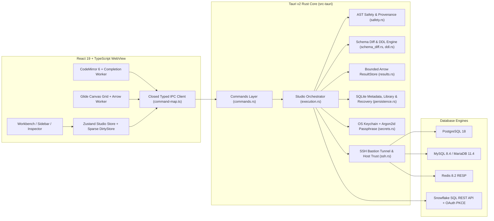

# Joinery Implementation & Release Status

**Canonical Plan, Capability Matrix & Shipping Status Ledger**  
*Last updated: 4 November 2026 · Repository: `quiinthieu/joinery`*

> [!IMPORTANT]
> **State Distinction Summary**
> - **Tested & Merged on `origin/main` (`bcb606f`)**: Milestones **R1–R8** and **RX.1** (all 78 DataGrip replacement matrix capabilities: 77 `Full`, 1 `Scoped` read-only by design, 0 `Partial`, 0 `Missing`). Verified by **513 frontend Vitest tests** (50 files), **176 standard Rust unit/integration tests**, **66+ disposable database/SSH/TLS Rust integration tests** (PostgreSQL 18, MySQL 8.4, MariaDB 11.4, Redis 8.2), and **117 Playwright E2E browser workflows** across all 6 GitHub Actions CI checks.
> - **Tested on PR `#71` (`fix/snowflake-completion-current-schemas`)**:
  1. Fixes Snowflake SQL auto-completion context query (`CURRENT_SCHEMAS()` without `TO_JSON(...)`), supports 3-part `database.schema.table` SQL completion across Snowflake/PostgreSQL/MySQL, preloads catalog tables into the completion worker, and fetches missing relation columns on demand in `SELECT`/`WHERE`/`ORDER BY`/`GROUP BY` clauses.
  2. Adds DataGrip-style default pagination (`500` rows per page, `First`/`Previous`/`Next`/`Last` page controls, `100` / `200` / `500` / `1,000` / `All rows` selector, 1-based page row numbering, and a 5,000-row eager multi-partition cap for un-limited Snowflake queries).
  3. Upgrades the studio theme, color system, and UI design with a multi-preset color palette picker (`Slate & Electric Blue` default, `Obsidian & Indigo`, `Graphite & Amber`, `Forest & Sage`) across `Studio dark`, `Paper light`, and `High contrast` appearance modes, richer SQL syntax highlighting (`SqlEditor.tsx`), palette-reactive Canvas data grid (`DatabaseGrid.tsx`), refined typography/controls (`styles.css`), and updated geometric brand emblem (`public/joinery.svg`).
> - **Published on GitHub Releases**: **`v0.1.0-preview.16`** (`bcb606f`, `Joinery-v0.1.0-preview.16-macos-arm64.zip`, archive SHA-256 `86a0584af7de3745bfebef893504e4611513132c24e461f086c3f65d1bbfd477`, `release-manifest.json`, `SHA256SUMS`).
> - **Installed Locally (`/Applications/Joinery.app`)**: Installed from `a5f0e89` (`22.49 MiB`, executable SHA-256 `1f854f3408250364cffdf5f7434e9672445c99453e874ee76a8035c32e65c9f5`), strict ad-hoc signature verified (`codesign --verify --deep --strict`), pinned to the macOS Dock (`com.quiinthieu.joinery`), with all 37 older cached `.app` bundles removed and unregistered from LaunchServices.
> - **Externally Qualified**: Local disposable fixtures and live Snowflake OAuth sign-in/catalog/completion context are verified; **Apple Developer ID signing/notarization**, **packaged Windows/Linux host runtime checks**, and **cold visible-startup / total WebKit helper idle RAM / 100+ FPS hardware gates** remain open.

---

## 1. System Architecture & Safety Gateway

Joinery is a native desktop database studio built on **Tauri v2**, **Rust**, **React 19**, **CodeMirror 6**, **Apache Arrow IPC**, and **Glide Data Grid** (HTML5 Canvas). Database drivers, SSH tunnels, TLS verification, SQL AST classification, DDL generation, and result memory budgets execute entirely inside the Rust process.

### Mutation & DDL Review Lifecycle

Every write path—whether raw SQL in the editor, staged cell/row edits in the data grid (`UPDATE` / `INSERT` / `DELETE`), CSV import batches, visual table/column/index/constraint editors, schema migration sync, table maintenance (`VACUUM` / `ANALYZE` / `REINDEX` / `OPTIMIZE`), or process cancellation—passes through the same expiring, SHA-256-fingerprinted plan and one-use approval gateway in [`execution.rs`](../src-tauri/src/execution.rs).

### Enforced Resource & Memory Budgets

| Resource | Hard Limit | Enforcement Point |
| :--- | :--- | :--- |
| **Rust `ResultStore` global memory** | **64 MiB** max, **100** retained results, **100,000 rows** per result | `src-tauri/src/results.rs` |
| **Arrow IPC frame size** | **4 MiB** per frame (checked prior to serialization) | `src-tauri/src/results.rs` |
| **Frontend `resultCache` Arrow buffer** | **32 MiB** max, **512** cached pages, **4** concurrent fetches | `src/data/result-cache.ts` |
| **Table browse page** | **500 rows** or **2 MiB** per keyset page | `src-tauri/src/drivers/{postgres,mysql,snowflake}.rs` |
| **Pending grid edits & review plans** | **8 MiB** review budget, **5,000** cells / **500** rows per batch | `src-tauri/src/execution.rs` |
| **Capability-gated `.sql` files** | **4 MiB** UTF-8, max **64** active file grants, atomic `.tmp` + `fsync` + `rename` | `src-tauri/src/file_capability.rs` |
| **Capability-gated CSV/TSV imports** | **16 MiB**, **5,000 rows**, **256 columns** | `src-tauri/src/import.rs` |
| **Streaming `.partial` data exports** | **1,000,000 rows** or **512 MiB** per job, max **2** concurrent exports | `src-tauri/src/export.rs` |
| **Schema snapshots (`D02`)** | **500** relations, **20,000** columns, **10,000** constraints/indexes | `src-tauri/src/domain.rs` |
| **SQLite metadata & recovery** | **32** drafts (**1 MiB** each / **2 MiB** total), **20** backup snapshots (**64 MiB** each) | `src-tauri/src/persistence/{workspace,recovery}.rs` |

---

## 2. Multi-Engine Support & Granular Capability Matrix (`M07`)

Every connected session advertises 15 granular capability fields on `EngineCapabilities` (`src-tauri/src/domain.rs`), enforced in both `Studio` backend RPCs (`ErrorCode::Unsupported`) and frontend controls.

| Capability Flag | PostgreSQL 18 | MySQL 8.4 / MariaDB 11.4 | Snowflake (Pilot) | Redis 8.2 |
| :--- | :---: | :---: | :---: | :---: |
| `sql` (Console execution) | Full | Full | Read-Only SQL API | Command Console |
| `transactions` (`Manual` / `AutoCommit`) | Full (`BEGIN`/`COMMIT`/`ROLLBACK`) | Full (+ implicit DDL commit guard) | Unsupported | Unsupported |
| `cancellation` | Backend PID + Cancel Key (quarantines session) | `KILL QUERY <conn_id>` on sibling connection | Statement handle cancel | Disconnect / timeout |
| `tableBrowsing` | Keyset PK pagination | Keyset PK pagination | Unordered 500-row / 2 MiB preview | `SCAN` cursor + type/TTL viewer |
| `tableEditing` | `SELECT … FOR UPDATE` + full-row conflict check | `SELECT … FOR UPDATE` on isolated connection | Disabled (Read-only) | Reviewed Redis write commands |
| `tableFiltering` | Server sort + Safe-Mode raw `WHERE`/`ORDER BY` | Server sort + Safe-Mode raw `WHERE`/`ORDER BY` | Disabled | `SCAN` pattern filter |
| `processes` (`A04`) | `pg_stat_activity` + `pg_cancel_backend` | `information_schema.processlist` + `KILL QUERY` | Unsupported | Unsupported |
| `objectExplorer` (`N01`–`N06`) | Tables, Views, MatViews, Functions, Procedures, Sequences, Triggers, Indexes | Tables, Views, Functions, Procedures, MariaDB Sequences, Triggers, Indexes | Database tables & views + columns | Keyspace browser |
| `schemaDiagram` (`D01`) | Full (`SchemaDiagram` FK graph) | Full (`SchemaDiagram` FK graph) | Unsupported | Unsupported |
| `schemaDiff` (`D02`–`D04`) | Full (`SchemaSnapshot`, diff, DDL, migration sync) | Full (`SchemaSnapshot`, diff, DDL, migration sync) | Unsupported | Unsupported |
| `ddlEditing` (`D05`, `N08`, `A06`) | Visual Table/Column/Index/Constraint + `ANALYZE`/`VACUUM`/`REINDEX` | Visual Table/Column/Index/Constraint + `ANALYZE`/`OPTIMIZE`/`CHECK` | Unsupported | Unsupported |
| `lockInspection` (`A05`) | `pg_locks` + `pg_blocking_pids()` wait chains | InnoDB `data_lock_waits` / `INNODB_LOCK_WAITS` | Unsupported | Unsupported |
| `explainAnalyze` (`Q01`–`Q07`) | `EXPLAIN (FORMAT JSON)` & reviewed `ANALYZE` (`PostgresJson`) | `EXPLAIN FORMAT=JSON` + MySQL `EXPLAIN ANALYZE FORMAT=TREE` / MariaDB `ANALYZE FORMAT=JSON` | Plain `EXPLAIN USING JSON` + `GET_QUERY_OPERATOR_STATS` | Unsupported |
| `oauthBrowser` | Disabled | Disabled | System-browser PKCE OAuth (`SNOWFLAKE$LOCAL_APPLICATION`) | Disabled |

---

## 3. DataGrip Replacement Capability Matrix (78 / 78 Capabilities)

### A. Database Management, Connections & Sessions (`M01`–`M07`)
| ID | Capability | Status | Key Implementation & Verification |
| :--- | :--- | :---: | :--- |
| **M01** | Connection profiles & environments | **Full** | `src/features/connections/ConnectionDialog.tsx`, `src-tauri/src/execution.rs` |
| **M02** | OS Keychain secrets & Snowflake OAuth PKCE | **Full** | `src-tauri/src/secrets.rs`, `src-tauri/src/drivers/snowflake.rs` |
| **M03** | SSH bastion tunnels, host trust & custom PEM CA TLS | **Full** | `src-tauri/src/ssh.rs`, `src/features/connections/SshHostTrust.tsx` |
| **M04** | Hierarchical connection groups & inherited policy | **Full** | `src/features/connections/GroupManager.tsx`, `src-tauri/tests/groups.rs` |
| **M05** | Per-session active schema / database switcher | **Full** | `src/features/studio/SqlEditor.tsx`, `tests/e2e/sessions.spec.ts` |
| **M06** | Named multi-console session pool (up to 4 per profile) | **Full** | `src/state/studio.ts`, `tests/e2e/consoles-files.spec.ts` |
| **M07** | Granular per-engine capability flags & gating | **Full** | `src-tauri/src/domain.rs`, `src-tauri/src/execution.rs` |

### B. Database Explorer, Object Inspection & Visual DDL (`N01`–`N08`)
| ID | Capability | Status | Key Implementation & Verification |
| :--- | :--- | :---: | :--- |
| **N01–N05** | Categorized schema tree (tables, views, matviews, routines, sequences, triggers, indexes) + WAI-ARIA keyboard navigation | **Full** | `src/features/connections/Sidebar.tsx`, `src/features/connections/explorer-tree.ts`, `tests/e2e/explorer.spec.ts` |
| **N06** | Object inspector, read-only 256 KiB DDL & 200-edge `Uses`/`Used by` dependency graph | **Full** | `src/features/studio/ObjectInspectorView.tsx`, `src/features/studio/UtilityViews.tsx` |
| **N07** | Cross-connection Search Everywhere (`⌘K` / `⇧⌘O`) | **Full** | `src/features/studio/SearchEverywhere.tsx`, `src/features/studio/search-everywhere.ts` |
| **N08** | Visual table & column creation/modification/drop UI (`CREATE TABLE`, `ADD`/`ALTER`/`DROP COLUMN`, `DROP TABLE`/`VIEW`) | **Full** | `src/features/studio/TableObjectDialog.tsx`, `src-tauri/src/ddl.rs`, `tests/e2e/table-object-editor.spec.ts` |

### C. SQL Editor, Completion, Inspections, Refactoring & Execution (`E01`–`E16`, `X01`–`X05`)
| ID | Capability | Status | Key Implementation & Verification |
| :--- | :--- | :---: | :--- |
| **E01–E05** | Dialect highlighting, live schema/table/alias completion, qualification & worker index | **Full** | `src/features/studio/SqlEditor.tsx`, `src/features/studio/sql-context.ts`, `src/features/studio/completion-session.ts` |
| **E06** | Foreign-key `JOIN … ON` condition completion (outbound & inbound single/composite FKs) | **Full** | `tests/e2e/fk-join-completion.spec.ts` |
| **E07–E10** | Inline SQL inspections, wildcard expansion (`Expand *`), and subquery/CTE/set-operation column provenance | **Full** | `src/features/studio/sql-inspections.ts`, `src/features/studio/sql-join-inspections.test.ts`, `tests/e2e/sql-column-inspections.spec.ts` |
| **E11–E12** | Go to definition (`F12`), find usages (`⇧F12`), quick docs (`F1`), and scoped alias/CTE rename (`⇧F6`) | **Full** | `src/features/studio/sql-navigation.ts`, `src/features/studio/SqlAliasRenameDialog.tsx`, `tests/e2e/sql-navigation.spec.ts` |
| **E13–E16** | Live SQL templates (`{{schema}}`, `{{database}}`, `{{selection}}`), per-engine formatter styles, `.sql` file Open/Save | **Full** | `src/features/studio/sql-snippets.ts`, `tests/e2e/sql-template-context.spec.ts` |
| **X01–X05** | Current-statement / selection / batch execution, typed `:named` & `$1` parameters, byte/Unicode error spans, statement timing | **Full** | `src/features/studio/ParameterDialog.tsx`, `src/features/studio/ExecutionTiming.tsx`, `tests/e2e/query-parameters.spec.ts` |

### D. Data Grid, Value Viewers, Data Movement & Result Editing (`G01`–`G14`)
| ID | Capability | Status | Key Implementation & Verification |
| :--- | :--- | :---: | :--- |
| **G01–G06** | Virtualized Canvas grid, keyset pagination, server sort/filter, column reorder/hide/resize persistence, outbound/inbound FK jumps | **Full** | `src/features/grid/DatabaseGrid.tsx`, `src/features/grid/TableFilterBar.tsx`, `tests/e2e/table-data.spec.ts` |
| **G07–G09** | Multi-row `UPDATE`/`INSERT`/`DELETE` staging, atomic TSV paste, rich value viewers (hex/ASCII binary, PG arrays, lossless JSON) | **Full** | `src/features/grid/ValueDialog.tsx`, `src/features/grid/paste.ts` |
| **G10–G13** | Copy-as (`CSV`/`TSV`/`JSON`/`NDJSON`/`SQL INSERT`/`Markdown`), `.partial` streaming export, CSV/TSV import, key-aware data compare | **Full** | `src/features/grid/ExportDialog.tsx`, `src/features/grid/ImportCsvDialog.tsx`, `src/features/grid/DataCompareDialog.tsx`, `tests/e2e/data-movement.spec.ts` |
| **G14** | Single-table `SELECT` query result editing with Rust AST + live catalog provenance verification | **Full** | `src-tauri/src/safety.rs`, `src-tauri/src/results.rs`, `tests/e2e/studio.spec.ts` |

### E. Diagrams, Schema Comparison, DDL Generation & Migration Sync (`D01`–`D05`)
| ID | Capability | Status | Key Implementation & Verification |
| :--- | :--- | :---: | :--- |
| **D01** | Read-only interactive schema ER diagrams (SVG pan/zoom, FK crow's-foot edges, PNG/SVG export) | **Scoped** | `src/features/diagram/DiagramView.tsx`, `src/features/diagram/er-layout.ts`, `tests/e2e/schema-diagram.spec.ts` |
| **D02** | Live schema snapshots & deterministic canonical schema comparison | **Full** | `src-tauri/src/schema_diff.rs`, `src/features/schema-diff/SchemaDiffView.tsx` |
| **D03** | Dependency-ordered Rust DDL generator (full schema & 7-phase migration DDL) | **Full** | `src-tauri/src/ddl.rs`, `tests/e2e/schema-diff.spec.ts` |
| **D04** | Reviewed migration checklist & live drift-checked schema synchronization | **Full** | `src-tauri/src/execution.rs`, `src/features/schema-diff/SchemaDiffView.tsx` |
| **D05** | Visual index & constraint editor (`CREATE`/`DROP INDEX`, `ADD`/`DROP CONSTRAINT`) | **Full** | `src/features/studio/IndexConstraintDialog.tsx`, `tests/e2e/index-constraint-editor.spec.ts` |

### F. Query Plans, Administration, Workspace Ergonomics & Architecture (`Q01`–`Q07`, `A01`–`A06`, `P01`–`P06`, `I01`–`I07`)
| ID | Capability | Status | Key Implementation & Verification |
| :--- | :--- | :---: | :--- |
| **Q01–Q07** | Estimated & reviewed `ANALYZE` plans (PG JSON, MySQL JSON/Tree, MariaDB JSON, Snowflake JSON + operator stats) & side-by-side plan diff | **Full** | `src/features/studio/QueryPlanView.tsx`, `src/features/studio/plan-snapshots.ts`, `tests/e2e/query-plans.spec.ts`, `tests/e2e/snowflake-plans.spec.ts` |
| **A01–A05** | Safe Mode policy, digest audit log, relation/index storage & bloat stats, process monitor, blocking lock-wait trees | **Full** | `src/features/studio/lock-chains.ts`, `src/features/studio/storage-stats.ts`, `tests/e2e/lock-monitoring.spec.ts` |
| **A06** | Reviewed table maintenance (`ANALYZE`, `VACUUM`, `REINDEX TABLE`, `OPTIMIZE TABLE`, `CHECK TABLE`) + non-transactional guards | **Full** | `src/features/studio/TableMaintenanceDialog.tsx`, `tests/e2e/table-maintenance.spec.ts` |
| **P01–P06** | Saved queries, bookmarks (`⌘D`), recent locations (`⇧⌘E`), contextual command palette, custom shortcut keymap, pinned/reopenable tabs | **Full** | `src/features/studio/shortcuts.ts`, `src/features/studio/Preferences.tsx`, `tests/e2e/workspace.spec.ts` |
| **I01–I07** | Closed typed IPC command map (`JoineryCommandMap`), SQLite WAL recovery & guarded backup/restore, WAI-ARIA keyboard accessibility | **Full** | `src/ipc/command-map.ts`, `src/features/studio/MetadataRecovery.tsx`, `tests/e2e/recovery.spec.ts` |

---

## 4. Merged Milestone & Pull Request Ledger

| Milestone / Slice | PR & Commit | Scope Summary | Verification Evidence |
| :--- | :--- | :--- | :--- |
| **Baseline & Previews 1–15** | `v0.1.0-preview.15` (`63dd98e3`) | Core PostgreSQL, MySQL/MariaDB, Redis 8.2, Snowflake pilot, SSH/TLS, Safe Mode, recovery | Published on GitHub Releases |
| **R1–R4** | PRs #25–#30 (`a0ba1a6`) | Grid sort/filter, FK navigation, value viewers, export/import/compare, object explorer, multi-console sessions, saved queries/bookmarks | Merged on `main`; 6 CI checks green |
| **R5–R6** | PRs #31–#60 (`a0a6df8`) | FK `JOIN` completion, typed parameters, inline SQL inspections, local symbol navigation, alias/CTE rename, live templates, query plans & diff | Merged on `main`; 6 CI checks green |
| **R7.1 (`D01`)** | PR #61 (`8f3a119`) | Read-only interactive schema ER diagrams (`DiagramView`) | 476 Vitest, 158 Rust unit, PG/MySQL fixtures, `schema-diagram.spec.ts`, 6 CI checks |
| **R8.1 (`A04` + `A05`)** | PR #62 (`80de7aa`) | Blocking lock-wait chains & session monitoring | 482 Vitest, 160 Rust unit, PG/MySQL/MariaDB lock fixtures, `lock-monitoring.spec.ts`, 6 CI checks |
| **R8.2 (`A03`)** | PR #63 (`0a04a74`) | Relation storage & per-index usage statistics (`TableStorageStats`) | 486 Vitest, 160 Rust unit, PG/MySQL/MariaDB stats fixtures, `explorer.spec.ts`, 6 CI checks |
| **R7.2 (`D02`)** | PR #64 (`046d05c`) | Bounded `SchemaSnapshot` & deterministic canonical schema diff (`SchemaDiffView`) | 488 Vitest, 162 Rust unit, PG/MySQL/MariaDB diff fixtures, `schema-diff.spec.ts`, 6 CI checks |
| **R7.3 (`D03`)** | PR #65 (`b67e65b`) | Dependency-ordered Rust DDL generator & 7-phase migration preview | 488 Vitest, 165 Rust unit, PG/MySQL/MariaDB round-trip DDL fixtures, `schema-diff.spec.ts`, 6 CI checks |
| **R7.4 (`D05`)** | PR #66 (`792aa99`) | Reviewed index & constraint editor (`IndexConstraintDialog`) | 491 Vitest, 167 Rust unit, PG/MySQL/MariaDB DDL fixtures, `index-constraint-editor.spec.ts`, 6 CI checks |
| **R7.5 (`N08`)** | PR #67 (`c855c04`) | Visual table & column DDL creation/modification editor (`TableObjectDialog`) | 494 Vitest, 169 Rust unit, PG/MySQL/MariaDB DDL fixtures, `table-object-editor.spec.ts`, 6 CI checks |
| **R7.6 (`D04`)** | PR #68 (`83b1260`) | Reviewed schema migration synchronization with live target drift detection | 495 Vitest, 170 Rust unit, PG/MySQL/MariaDB sync fixtures, `schema-diff.spec.ts`, 6 CI checks |
| **R8.3 (`P05` + `P06`)** | PR #69 (`8be971a`) | Contextual command palette, custom keyboard shortcuts, tab pinning & reopen closed tab | 506 Vitest, 171 Rust unit, `workspace.spec.ts`, 6 CI checks |
| **R8.4 + R8.5 + RX.1 (`I03`, `M07`, `A06`, `G14`)** | PR #70 (`bcb606f`) | Closed typed `JoineryCommandMap`, granular `EngineCapabilities`, reviewed table maintenance (`TableMaintenanceDialog`), single-table `SELECT` result editing | 513 Vitest, 176 Rust unit, PG/MySQL/MariaDB fixtures, 117/117 Playwright E2E tests, 6 CI checks; published as `v0.1.0-preview.16` |
| **Snowflake completion, DataGrip default pagination & Studio UI theme redesign (`E02-SF`, `G01`, `I07`)** | PR #71 (`fix/snowflake-completion-current-schemas`) | Query `CURRENT_SCHEMAS()` without `TO_JSON(...)`, 3-part `db.schema.table` completion & on-demand column hydration across engines, DataGrip-style 500-row default pagination (`GridPaginationBar`), 5,000-row eager Snowflake partition cap, and multi-palette studio UI redesign (`slate`, `obsidian`, `graphite`, `sage` × `dark`/`light`/`contrast`) | 524 Vitest, 176 Rust unit, `snowflake.spec.ts`, `workspace.spec.ts`, `pnpm validate`, macOS release bundle verified |

---

## 5. Open v1.0 Release & External Qualification Gates

> [!WARNING]
> **Do not mark these gates complete until demonstrated on the target host or external account with explicit owner authorization.**

1. **Apple Developer ID Signing & Notarization (`I06`)**:
   - Current macOS bundles use verified ad-hoc resource sealing (`scripts/verify-macos-bundle.mjs`). Developer ID signing and Apple notarization require Apple Developer credentials.
2. **Packaged Windows & Linux Host Qualification (`I06`)**:
   - GitHub Actions verifies native compilation (`check (windows-latest)`, `check (ubuntu-latest)`), but packaged installer and native WebView smoke qualification on physical/VM Windows and Linux hosts remain open.
3. **Live External Production Account Qualification (`M02`, `G01`)**:
   - Qualify remaining live customer Snowflake workflows (multi-partition previews, token refresh, cancellation) and external cloud-managed PostgreSQL/MySQL/Redis topologies.
4. **Hardware Performance Qualification (`I05`)**:
   - Qualify cold visible first-paint startup (<1s target), total idle memory including WebKit helper processes (50–80 MB target), and 100+ FPS scrolling on representative hardware.
