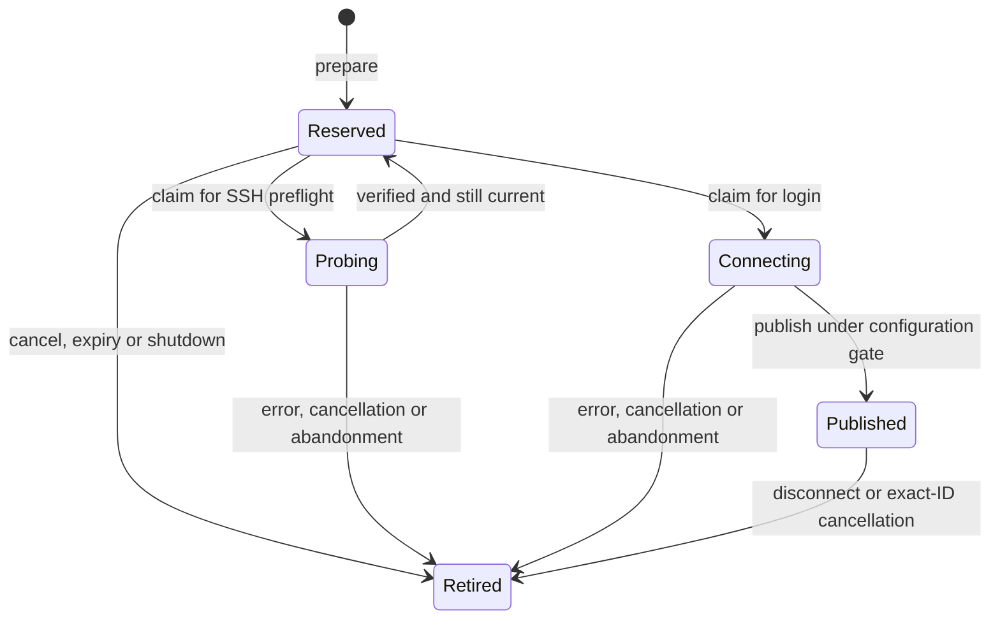

# Connection setup and shutdown ownership

This describes the active connection-lifecycle increment. Combined qualification
is tracked in the [verification ledger](replacement-verification.md); source
presence does not establish Snowflake externalbrowser readiness.

## One identifier from preflight to session

`prepare_connection` reserves a server-generated UUID against a saved profile.
The UI obtains it before starting SSH host-key verification or database login.
`probe_ssh` can claim that reservation for preflight and return it to the reserved
state on success. `connect_prepared` then claims the same identifier and uses it
as the published session ID. A reservation has one owner at a time.

Capacity is 32 open/pending connections overall and four per profile. Unclaimed
reservations expire after 60 seconds; successful preflight renews that interval
for the host-trust decision. Claimed work retains capacity until its future
unwinds, even after cancellation. These are explicit implementation limits;
their suitability for the owner's complete DataGrip workflow is not accepted.

Profile save/delete cancels older attempts, including an unchanged save. Metadata
restore refuses pending setup. A prepared preflight cannot revive a reservation
after cancellation, mutation, expiry or shutdown. Legacy `connect` and `probe_ssh`
callers also receive backend ownership; a standalone legacy probe releases its
temporary reservation when it finishes.

## Cancellation and late responses

`cancel_connection_attempt` serializes with credential persistence and publication
through the configuration gate. If publication already won and its reply is lost,
the same UUID identifies the exact session to retire immediately. A newer session
for the same profile is unaffected. Repeating cancellation/disconnect is safe.

The UI declines late session responses after cancellation or unmount and also
disconnects their exact returned ID. A failed cleanup reports an error and keeps
the identifier for retry during application close. Declining a host-trust prompt
or failing preflight releases an unadopted reservation. Cancel does not delete a
successfully saved connection profile.

A lost preparation response leaves the UI without its UUID. The server's
unclaimed-reservation expiry bounds that capacity; shutdown cancels it directly.
No authentication is dispatched until the UI has received the identifier.

## Native close and socket ownership

Native close/quit requires the frontend's pending-work decision. After approval,
the UI blocks new interaction, flushes workspace state, rechecks pending work,
cancels setup, awaits `app_shutdown`, then destroys the window. Save/cleanup
failure keeps the window open and reports the error. A missing frontend
acknowledgement is not permission for a timed forced exit.

Backend shutdown first prevents admission/publication, then retires sessions and
waits for claimed setup owners to unwind. PostgreSQL startup owns its spawned
socket task before awaiting identity. SSH probe and tunnel startup retain a
socket shutdown owner while russh key exchange/authentication runs. MySQL supplies
the dependency's client-side cached timeout so its internal settings query cannot
run before the application's connection cleanup wrapper exists; this does not
change the server's timeout.

This drain establishes local setup retirement. It does not prove that a remote
write failed or a transaction rolled back. SQL outcome checks and actual database
observers remain required. SDK helper cleanup receipts must be integrated with
shutdown before externalbrowser application qualification.

## Regression and acceptance evidence

- `src-tauri/src/connection_attempts.rs` tests reservation transitions, capacity,
  cancellation and shutdown races.
- `src-tauri/src/execution/connection_tests.rs` exercises production setup against
  a real loopback RESP peer, including credential and publication barriers.
- `src-tauri/tests/postgres_protocol.rs`, `ssh_startup.rs`, `ssh_preflight.rs` and
  `src-tauri/src/drivers/mysql/startup_tests.rs` use isolated wire peers and SSH
  fixtures to observe socket teardown and exact preflight ownership. They do not
  substitute for real database-engine qualification.
- Connection-dialog and window-close unit tests cover delayed responses, failed
  cleanup, trust decisions, persistence ordering and interaction blocking.
- Browser tests use real disposable PostgreSQL for connection cancellation. Any
  intercepted SSH browser fixture is synthetic and must be identified separately.
- Hidden native smoke checks actual command permissions and the irreversible
  shutdown barrier. Native recovery uses actual disposable PostgreSQL to verify
  rollback and restored drafts without automatic connection or SQL replay.

Run `pnpm validate`, the real fixture suite, browser workflows and native checks
as recorded in the ledger. Record source identity, failures and blocked checks;
passing wire fixtures alone does not qualify engine, account or packaged behavior.

## Test-harness isolation

The local browser harness has a separate fixture reset. It cancels attempts,
exports and file capabilities and retires the session snapshot under the same
configuration gate, then awaits only the claimed setup owners it canceled.
Requests admitted after that snapshot own fresh work and do not extend the drain.
The helper is test-only and cannot reopen real shutdown admission. Reusing
application shutdown for fixture reset or waiting for global idleness with open
admission would violate that contract; both defects have reproduced regressions.
